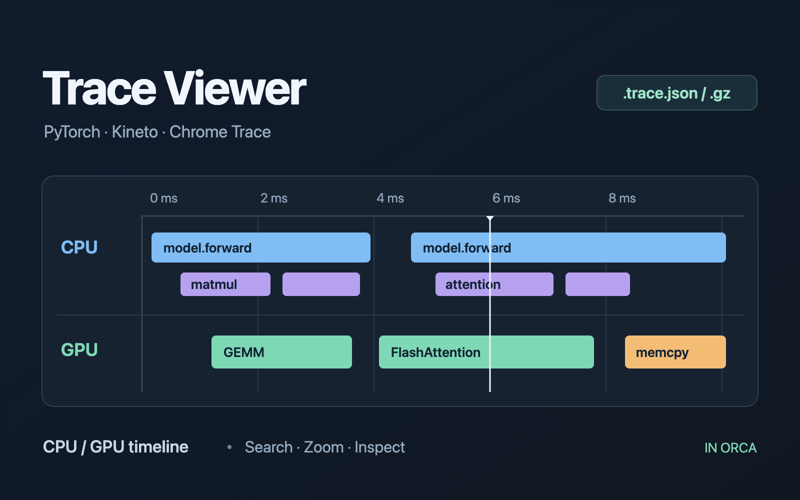

# Orca Trace Viewer

An offline CPU/GPU timeline viewer for PyTorch and Kineto Chrome traces, inside Orca.



在 Orca 桌面版直接查看 PyTorch profiler / Kineto 导出的 Chrome Trace，支持 JSON 和 gzip，离线运行。

## 安装

在 Orca 终端执行：

```sh
orca plugin install piDack/orca-trace-viewer@v0.1.1 --json
```

按输出提示确认插件权限。通过 GitHub 安装后的插件 ID 为 `pidack.trace-viewer`。

## 使用

- 打开 `*.trace.json`、`*.pt.trace.json` 或对应的 `.gz` 文件即可显示时间线。
- 其他名称的 `*.json`：打开文件后，点击编辑器的 **Trace** 切换项。Orca 的内置 JSON 查看器优先，插件无法按 JSON 内容自动接管。可以将 trace 命名为 `xxx.trace.json`，方便下次直接打开。
- 下拉框筛选 CPU / GPU；输入事件名或 category 搜索，Enter / Shift+Enter 跳转匹配结果。
- 点击事件查看耗时和参数；双击聚焦。拖动平移，Ctrl/⌘ + 滚轮缩放，普通滚轮上下滚动。
- 快捷键：W/S 放大/缩小，A/D 左右平移，F 显示完整 trace，`/` 聚焦搜索框。

查看、搜索和缩放不会修改文件。文件被外部程序替换后，视图会重新加载。

## 支持范围

支持 `traceEvents` 对象和事件数组；绘制 complete (`X`)、begin/end (`B`/`E`)、instant (`i`/`I`)、mark (`R`) 事件，以及进程/线程元数据。Chrome Trace 的 `ts` / `dur` 按微秒解释，即使 Kineto 标记 `displayTimeUnit: "ns"`；时间轴从第一条事件开始计时。

当前版本不绘制 flow 连接箭头、counter 曲线和 async 事件。鼠标悬停顶部统计可查看未绘制的事件数量。时间线按线程拆分不重叠的行，用 Canvas 绘制可视范围。

需要 Orca 桌面版 **1.4.248+** 并启用隔离插件 frame；浏览器客户端会回到 Source 视图。

## 本地安装

```sh
orca plugin install /absolute/path/to/orca-trace-viewer --json
```

首次安装会显示本次插件的权限和 approval fingerprint；核对后按输出给出的 `--approve` 命令启用。插件仅在沙箱编辑器内运行、读取打开的文档，不申请额外主机能力。安装会保存插件副本，原始目录保留用于开发。

需要打开某个文件时也可使用：

```sh
orca plugin open pidack.trace-viewer --editor /absolute/path/to/profile.trace.json --json
```

如果从本地目录安装，将命令中的插件 ID 换为 `local.trace-viewer`。

## 开发与验证

无运行时依赖、无打包步骤；Orca 直接加载 TypeScript。

```sh
orca plugin dev load . --json
orca plugin types . --json
npx --yes --package typescript tsc -p .
orca plugin test . --json
orca plugin check . --json
orca plugin validate . --json
orca plugin shot . --editor /absolute/path/to/profile.trace.json --out .orca/shots/trace.png --json
```

`editor/trace.ts` 解析并排列事件，`editor/main.ts` 绘制时间线和处理交互，`editor/sync.ts` 负责 Orca 文档会话和 gzip 解压。JSON 注册为文本编辑器，gzip 单独注册为二进制编辑器：Orca 的普通 JSON 文档不提供二进制入口。`.orca/` 是 Orca 生成的类型和本地验证产物，不需分发。

`examples/demo.trace.json` 提供 CPU 调度、GPU kernel 和 memcpy 的小型示例。

## License

[MIT](LICENSE) © 2026 piDack.
